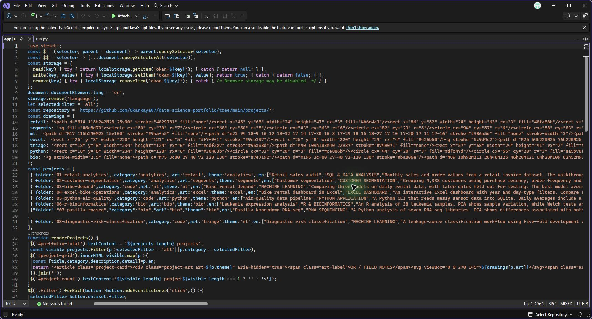
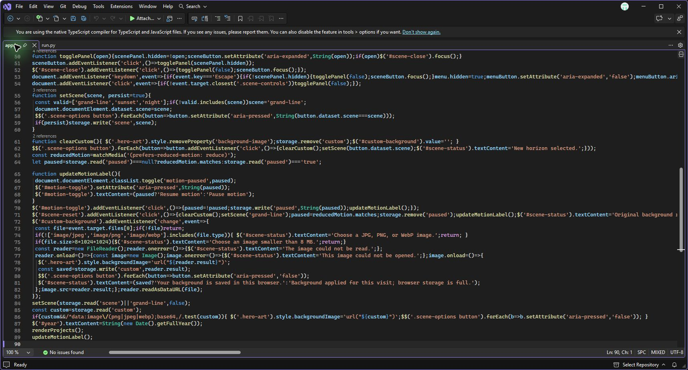

# Visual Studio walkthrough

1. Open `app.js` in Visual Studio. The `projects` array defines the cards and their links to the source projects.

   

2. Go to the end of `app.js` to see how the scene presets, reduced motion preference and custom background work.

   

3. Follow the [local preview instructions](../../README.md#editing-and-preview). Open the local page, select a project category and switch between background presets to see the two parts of the script in use.
